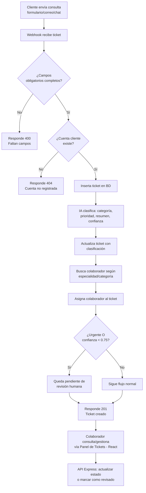

# Sistema Inteligente de Gestión de Tickets

Automatización del proceso de recepción, clasificación y asignación de tickets de soporte, con IA aplicada como componente de decisión — no como chatbot.

## El problema que resuelve

En mi experiencia trabajando en soporte técnico y luego supervisando un equipo de soporte, una parte significativa del tiempo del equipo se iba en tareas puramente repetitivas: leer cada solicitud de un cliente, identificar si correspondía a soporte técnico o a ventas, determinar qué tan urgente era, y asignarla a la persona correcta — antes de que nadie pudiera empezar siquiera a resolver el problema real.

Este sistema automatiza ese proceso de recepción y clasificación inicial. Cuando un cliente escribe una consulta (por cualquier canal: formulario, correo, chat), el sistema valida que la cuenta exista, usa un modelo de lenguaje para clasificar la solicitud (categoría, prioridad, resumen), y asigna automáticamente un colaborador con la especialidad correcta — sin que nadie tenga que leerlo manualmente primero.

La pieza clave del diseño es que el sistema no confía ciegamente en la IA: cada clasificación viene acompañada de un puntaje de confianza, y cualquier ticket marcado como urgente o con baja confianza se escala automáticamente para revisión humana antes de proceder — el sistema automatiza lo repetitivo, pero mantiene el criterio humano donde realmente importa.

## Arquitectura

## Stack técnico

- **Orquestación:** n8n (webhook, validación, lógica condicional)
- **IA:** Google Gemini API (structured outputs vía `response_mime_type: application/json`)
- **Base de datos:** PostgreSQL (Supabase) — esquema relacional con 3 tablas y constraints `CHECK` para valores cerrados de estado/prioridad
- **API de gestión:** Node.js + Express (CRUD de tickets, endpoints separados por responsabilidad)
- **Frontend:** React + Tailwind CSS

## Esquema de base de datos

- `tbl_cliente_ticket` — cuentas titulares registradas
- `tbl_colaborador` — agentes de soporte, con especialidad (`ventas` / `soporte_tecnico`)
- `tbl_ticket` — el ticket en sí, con relación a cliente y colaborador asignado, más los campos generados por IA (`categoria`, `prioridad`, `resumen`, `confianza`)

## Decisiones de diseño

**¿Por qué dos criterios para la revisión humana (urgencia Y confianza baja), no solo uno?**
Porque son dos riesgos distintos. Un ticket urgente pero claro no necesita que un humano lo revise antes de asignarse — solo necesita atención rápida. Pero un ticket ambiguo, aunque no sea urgente, sí necesita revisión, porque la IA no siempre puede detectar con certeza de qué se trata una consulta poco clara, y una clasificación equivocada ahí podría enviarse al departamento incorrecto sin que nadie lo note.

**¿Por qué separar "actualizar estado" de "marcar como revisado" en dos endpoints distintos?**
Porque son acciones distintas que no siempre ocurren juntas: un colaborador puede estar trabajando en un ticket (cambiando su estado de `nuevo` a `en_progreso`) sin que eso signifique que ya confirmó si la IA lo clasificó bien. Forzar ambas cosas en una sola actualización asumiría una relación que no existe en el proceso real.

**¿Por qué asignación automática de colaborador, en vez de una cola compartida sin asignar?**
Porque una cola sin dueño específico es más fácil de descuidar — es más sencillo que un ticket se quede esperando o se salte por pereza cuando nadie es responsable directo de él. Asignar automáticamente un colaborador según su especialidad mantiene el trabajo ordenado desde el inicio y evita que casos se pierdan por falta de dueño claro.

## Casos de prueba documentados

| Mensaje del cliente | Categoría | Prioridad | Confianza | ¿Revisión humana? |
|---|---|---|---|---|
| "El sistema de facturación no me deja generar el reporte mensual, me sale un error al hacer clic en exportar." | soporte_tecnico | alta | 0.95 | No |
| "Se cayó todo el sistema, no puedo facturar nada y tengo clientes esperando en este momento, es urgente." | soporte_tecnico | urgente | 0.98 | Sí (por prioridad) |
| "Hola, ya no puedo hacer lo que hacía antes, no sé qué pasó, ayúdenme porfa." | soporte_tecnico | media | 0.70 | Sí (por baja confianza) |

Los 3 casos confirman que ambos criterios de escalamiento funcionan de forma independiente: un ticket puede escalarse por ser urgente aunque la IA esté muy segura de su clasificación, o puede escalarse por baja confianza aunque no sea urgente.

## Endpoints de la API (`api-tickets`)

| Método | Ruta | Descripción |
|---|---|---|
| GET | `/tickets` | Lista tickets, con filtros opcionales `?estado=` y `?id_colaborador=` |
| GET | `/tickets/:id` | Detalle de un ticket específico |
| PUT | `/tickets/:id/estado` | Actualiza únicamente el estado del ticket |
| PUT | `/tickets/:id/marcar-revisado` | Confirma revisión humana, con corrección opcional de categoría/prioridad |

## Errores reales resueltos durante la construcción

- **Tipo de dato inconsistente:** el driver de Postgres devuelve columnas `DECIMAL` como texto, no como número — causaba comparaciones de tipo incorrectas en la lógica condicional (`'0.95' as string` vs `0.95` as number). Resuelto forzando conversión explícita con `Number(...)`.
- **Referencia a nodo incorrecto en n8n:** una condición de flujo tomaba datos del nodo inmediatamente anterior (que no incluía los campos necesarios en su `RETURNING`) en vez del nodo de clasificación real. Resuelto usando referencia explícita `$('NombreDelNodo')`.
- **Fallo transitorio de la API de IA:** error `503` por saturación temporal del servicio — documentado como caso real que justifica implementar retry con backoff en proyectos posteriores.

## Lo que este proyecto demuestra

La combinación de mi experiencia real en procesos de soporte con las herramientas modernas de automatización e IA: no es un ejercicio genérico de clasificación de texto, es el mismo problema de negocio que viví de primera mano, resuelto con criterio de diseño real (validación exhaustiva, manejo de errores, decisiones de negocio explícitas sobre cuándo confiar en la IA y cuándo no).